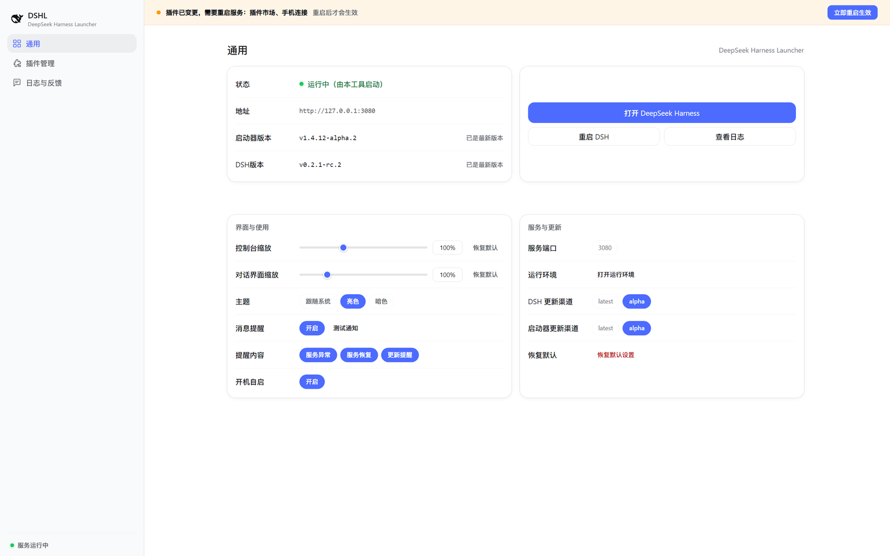
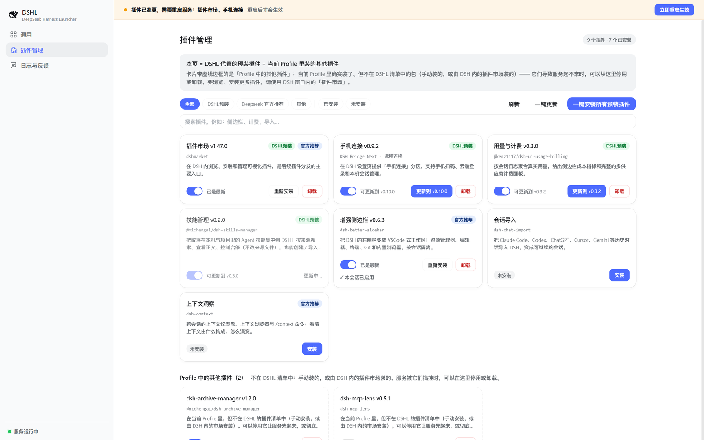
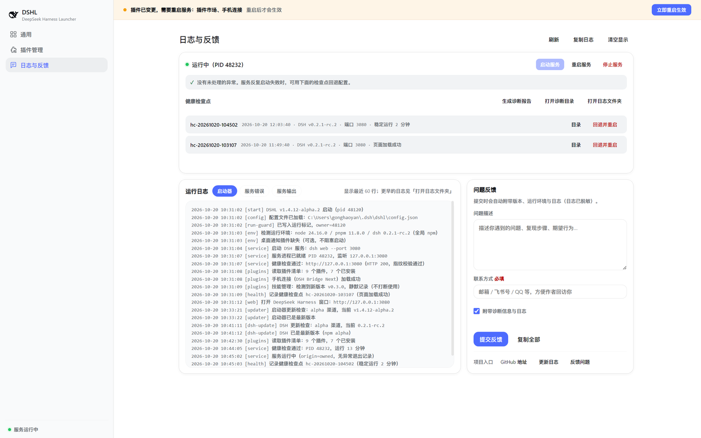
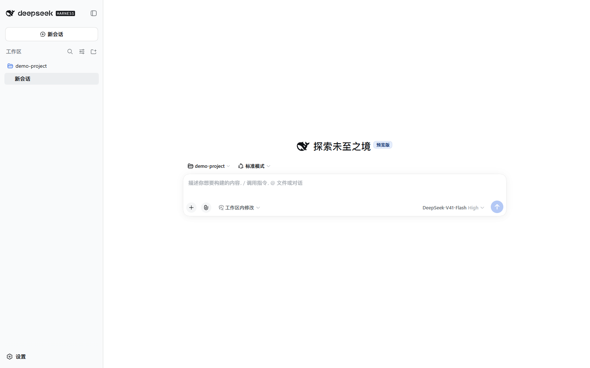

# DeepSeek Harness Launcher（DSHL）

给 [DeepSeek Harness](https://github.com/deepseek-ai/deepseek-harness)（简称 DSH）用的 Windows 托盘启动器。

它把运行环境、服务启停、插件和更新都收进一个桌面程序：装好就能用，日常操作点几下就行，不用记命令。

支持 **Windows 10 / 11（64 位）**。不需要提前安装 Node.js、npm、pnpm 或 DSH。

> macOS / Linux 的代码还在仓库里，但没有测试过，暂不承诺可用。

## 截图

<table>
  <tr>
    <td width="50%"></td>
    <td width="50%"></td>
  </tr>
  <tr>
    <td width="50%"></td>
    <td width="50%"></td>
  </tr>
</table>

## 三步开始用

1. **下载安装**：去 [Releases](https://github.com/IMHaoyan/deepseek-harness-launcher/releases) 下载最新的 `dshl-<版本>.exe`，双击安装。安装器不需要管理员权限。
2. **第一次打开，跟着向导走**：勾选想要的插件 → 等它把运行环境自动装好 → 进入 DeepSeek Harness。不想装插件也可以直接跳过，以后随时能在插件页补装。装 Node.js 时会弹一次管理员授权，点「是」即可；如果系统不允许，DSHL 会自动改用不需要管理员的安装方式。
3. **以后从托盘用它**：启动器会常驻托盘、开机自启。需要管理时，点标题栏右侧的「控制台」，或者右键托盘图标。

> Windows 提示「未知发布者」是正常的：安装包没有做代码签名。点「更多信息 → 仍要运行」就能继续。

## 它能帮你做什么

| 你想省掉的事 | DSHL 怎么做 |
| --- | --- |
| 手动装环境 | 自动检测并安装 Node.js、pnpm 和 DSH；机器上已有能用的 Node 会直接复用，不重复安装 |
| 记命令、手动启停服务 | 托盘里一键启动 / 停止 / 打开 DSH；服务意外退出会自动拉起，反复失败会自动回退到上一个能用的配置 |
| 一个个装插件 | 首次设置勾选，之后自动补齐；插件页可以安装、卸载、启用、停用、更新，坏插件也能一键停用 |
| 手动检查更新 | 启动器和 DSH 都会在后台检查更新；DSH 更新失败会自动回滚，不会把你卡在打不开的版本上 |
| 错过 DSH 的消息 | DSH 完成或向你提问时，托盘图标闪烁提醒，点一下回到对话 |
| 出了问题不知道找谁 | 控制台里有运行日志、诊断报告，也能一键把问题反馈给作者 |

## 控制台里有什么

点标题栏右侧的「控制台」打开。它和 DSH 在同一个窗口里，来回切换不会丢会话、丢输入。

- **通用** —— 看服务状态，打开 / 启动 / 重启 DSH，检查更新，调整偏好设置。
- **插件管理** —— 管理推荐插件：安装、更新、启停、卸载，也能一键更新全部。
- **日志与反馈** —— 看日志、生成诊断报告、回退到上一份能用的配置、把问题发给作者。

首次设置默认勾选 6 个插件：插件市场、手机连接、用量与计费、技能管理、对话回退、MCP 连接器。可以按需增减，之后也能在插件页手动安装。想发现更多插件，去 DSH 窗口里的「插件市场」逛逛。

## 更新

- **启动器自己**：后台静默下载，下次退出时自动装好。更新渠道在「通用 → 服务与更新」里切换：稳定版（`latest`，默认）或尝鲜版（`alpha`）。
- **DSH**：发现新版本会在界面提示，点一下就能更新；更新前自动停服，更新后重启并刷新页面，失败会自动回滚到旧版本。
- 国内网络访问 GitHub 慢时，更新源可以自动回退到国内加速；也可以固定为只走 GitHub。

## 常见问题

**需要提前装 Node.js 吗？**
不需要。DSHL 会自己检测和安装；机器上已有能用的 Node 会直接复用。

**我的数据存在哪？卸载会丢吗？**
配置、日志和会话都在用户目录下的 `.dsh` 文件夹（`C:\Users\<你的用户名>\.dsh`）。卸载启动器不会删除它们，想彻底清理再手动删掉这个目录。

**端口被占用了怎么办？**
控制台会提示，可以一键换成空闲端口，也可以自己指定端口。

**DSH 起不来了怎么办？**
打开「控制台 → 日志与反馈」，顶部会直接给出原因和建议动作（比如停用坏插件、回退配置）。处理不了就生成诊断报告，或者直接反馈给作者。

**想用新功能怎么办？**
在「通用 → 服务与更新」里把 DSH 或启动器的更新渠道切到尝鲜版（`alpha`）。切回稳定版不会降级，等下一个正式版即可。

**怎么卸载？**
控制面板 → 卸载程序。`.dsh` 文件夹里的数据会保留。

## 开发者

```powershell
npm install            # 安装依赖
npm start              # 开发模式运行
npm run dev            # 改界面自动重建并刷新，改主进程自动重启
npm test               # 单元测试
npm run dist:win       # 打包 Windows 安装包 → dist/dshl-<版本>.exe
```

更多内容：

- [开发与发布](./docs/development.md)：目录结构、新增插件、配置项、VS Code 调试、发布流程
- [内部机制与排障](./docs/internals.md)：稳定性与崩溃判定、环境安装、插件操作、更新与回滚
- [桌面快捷键模式](./docs/desktop-shell.md)

## 已知限制

- 安装包没有代码签名，首次安装可能被 SmartScreen 或安全软件提示。
- 主要在 Windows 上开发和测试；macOS / Linux 版本未测试。
- Windows 开发模式（`npm start`）下，系统通知的来源会显示为 "Electron"；安装版显示产品名。

## 许可证

[MIT](./LICENSE)

---

本项目完全由 DeepSeek Harness 搭载 DeepSeek 模型通过 Vibe coding 得到。
